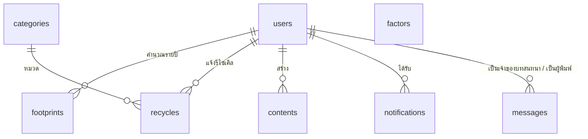

# GreenLoop

เว็บแอปพลิเคชัน Green Digital: วัดคาร์บอนฟุตพริ้นท์รายปี ลดด้วยการรีไซเคิลขยะอิเล็กทรอนิกส์ แล้วรับแต้มสะสมเพื่อเลื่อนระดับ
สมาชิกแนบรูปโปรไฟล์และรูปสินค้าที่จะรีไซเคิลได้ แชทกับผู้ดูแลระบบได้ และมีการแจ้งเตือนทั้งฝั่งสมาชิกและผู้ดูแล

เขียนให้สั้นและจำง่ายสำหรับซ้อมแข่ง: **19 ไฟล์ PHP 965 บรรทัด + `database.sql` 149 บรรทัด (8 ตาราง) + CSS 14 บรรทัด**
ใช้ PHP + MySQL + Bootstrap 5 + Chart.js บน XAMPP ไม่มี JavaScript ที่ต้องเขียนเอง

แผนซ้อมแข่ง 7 + 1 ชั่วโมง: [docs/PRACTICE_PLAN.md](docs/PRACTICE_PLAN.md)

## ติดตั้ง

1. คัดลอกโฟลเดอร์นี้ไปไว้ที่ `C:\xampp\htdocs\greenloop` (ต้องมีโฟลเดอร์ `uploads` สำหรับเก็บรูป)
2. phpMyAdmin → Import → `database.sql` (ไฟล์นี้ลบแล้วสร้างฐานข้อมูล `greenloop` ใหม่พร้อมข้อมูลตัวอย่าง)
3. เปิด `http://localhost/greenloop/`

| บทบาท | อีเมล | รหัสผ่าน |
| --- | --- | --- |
| ผู้ดูแลระบบ | admin@greenloop.local | admin1234 |
| สมาชิก (มีแชทกับผู้ดูแล และแจ้งเตือนที่ยังไม่อ่าน) | demo@greenloop.local | demo1234 |
| สมาชิก (มีคำขอรีไซเคิลรอตรวจรับ) | wichai@greenloop.local | demo1234 |

บัญชีตัวอย่างทุกบัญชีใช้คำถามกันลืม "ชื่อสัตว์เลี้ยงตัวแรกของคุณ" คำตอบคือ `greenloop`

## โครงสร้างไฟล์

```
init.php        ส่วนกลาง: ฐานข้อมูล ตัวช่วย สิทธิ์ แจ้งเตือน อัปโหลดรูป แชท โครงหน้าเว็บ
database.sql    ส่วนกลาง: โครงสร้าง 8 ตาราง + ข้อมูลตัวอย่าง
assets/         ส่วนกลาง: Bootstrap 5, Chart.js และ style.css (หน้าตาของระบบ 14 บรรทัด)
uploads/        ส่วนกลาง: รูปโปรไฟล์และรูปสินค้าที่ผู้ใช้แนบ
*.php           หน้าบ้าน: 11 ไฟล์สำหรับผู้เยี่ยมชมและสมาชิก
admin/*.php     หลังบ้าน: 7 ไฟล์สำหรับผู้ดูแลระบบ
```

### ส่วนกลาง

| ไฟล์ | บรรทัด | เกณฑ์ที่ตอบ |
| --- | --- | --- |
| `database.sql` | 149 | งานฐานข้อมูล: 8 ตาราง PK FK ชนิดและขนาดข้อมูล |
| `init.php` | 205 | Session, ตรวจสิทธิ์ทุกหน้า, Role-based access, Validate, Responsive (navbar) |

### หน้าบ้าน (ผู้เยี่ยมชมและสมาชิก)

| ไฟล์ | บรรทัด | เมนู | เกณฑ์ที่ตอบ |
| --- | --- | --- | --- |
| `index.php` | 63 | หน้าแรก | ส่วนต้อนรับ ขั้นตอนใช้งาน ผลกระทบรวม ข่าวสารตามเวลาเปิด-ปิด, ค้นหา |
| `login.php` `logout.php` | 29 | เข้าสู่ระบบ / ออกจากระบบ | Login - Logout, เข้ารหัสรหัสผ่าน (`password_verify`) |
| `register.php` | 34 | สมัครสมาชิก | สมัครสมาชิกพร้อมรูปโปรไฟล์ เลือกคำถามกันลืมและตั้งคำตอบ, Validate, แจ้งเตือนสมาชิกใหม่ |
| `forgot.php` | 23 | ลืมรหัสผ่าน | ยืนยันด้วยอีเมล คำถามที่เลือกไว้ และคำตอบ แล้วตั้งรหัสผ่านใหม่ |
| `profile.php` | 42 | โปรไฟล์ | แก้ไขโปรไฟล์ เปลี่ยนรูป, แก้ไขรหัสผ่าน |
| `footprint.php` | 56 | คำนวณคาร์บอน | Green ฝั่งผู้ใช้ 1: คำนวณคาร์บอนฟุตพริ้นท์, คำแนะนำ, กราฟรายปี |
| `recycle.php` | 59 | รีไซเคิล | Green ฝั่งผู้ใช้ 2: แจ้งรีไซเคิลพร้อมรูปสินค้า ติดตามสถานะ, ค้นหา, เรียงลำดับ |
| `points.php` | 48 | แต้มของฉัน | แรงจูงใจ: แต้ม ระดับสมาชิก อันดับ |
| `issue.php` | 17 | แชทกับผู้ดูแลระบบ | แชทกับผู้ดูแลระบบ (สมาชิกลบแชทไม่ได้) |
| `notifications.php` | 30 | 🔔 | การแจ้งเตือนของผู้ใช้ปัจจุบัน ใช้ร่วมกันทั้งสมาชิกและผู้ดูแล |

### หลังบ้าน (ผู้ดูแลระบบ)

| ไฟล์ | บรรทัด | เมนู | เกณฑ์ที่ตอบ |
| --- | --- | --- | --- |
| `admin/index.php` | 38 | Dashboard | ตัวเลขสรุป 8 ช่อง กราฟ 3 ชุด แจ้งเตือนล่าสุด |
| `admin/users.php` | 29 | สมาชิก | จัดการสมาชิก: ค้นหา ระงับสิทธิ์ |
| `admin/contents.php` | 55 | เนื้อหา | เพิ่ม ลบ แก้ไข ค้นหา ตั้งเวลาเปิด-ปิด |
| `admin/green.php` | 65 | ตั้งค่า Green | Green ฝั่งผู้ดูแล 1: ค่าสัมประสิทธิ์และหมวดขยะ |
| `admin/recycles.php` | 51 | รีไซเคิล | Green ฝั่งผู้ดูแล 2: ดูรูป ตรวจรับด้วยน้ำหนักจริง ให้แต้มและ CO₂e |
| `admin/issues.php` | 50 | แชทกับสมาชิก | เห็นสมาชิกทุกคน อ่าน ตอบ เริ่มแชทก่อน และลบแชททั้งหมดของสมาชิกคนนั้นได้ |
| `admin/reports.php` | 71 | รายงาน | รายงานสมาชิก เนื้อหา Green: กรอง ค้นหา กราฟ พิมพ์ ส่งออก CSV |

## สามส่วนที่เพิ่มเข้ามา

### แนบรูป

- ฟังก์ชัน `upload('ชื่อช่อง')` ใน `init.php` ตรวจว่าเป็นรูปจริงด้วย `getimagesize` รับเฉพาะ JPG PNG GIF ไม่เกิน 2MB ตั้งชื่อไฟล์ใหม่เองแล้วเก็บใน `uploads/` ฐานข้อมูลเก็บเฉพาะชื่อไฟล์
- ฟอร์มที่แนบรูปต้องมี `enctype="multipart/form-data"`
- `pic($file, $size, $icon, $link)` แสดงรูป ถ้าไม่มีรูปแสดงไอคอนแทน ใส่ `$link = true` เมื่อต้องการให้กดดูขนาดเต็ม และห้ามใช้ค่านี้กับรูปที่อยู่ภายในลิงก์อื่น เพราะลิงก์ซ้อนกันทำให้คลิกไม่ได้
- ใช้ 2 ที่: รูปโปรไฟล์ (`users.avatar`) และรูปสินค้ารีไซเคิล (`recycles.image`)

### แชทกับผู้ดูแลระบบ

- ตาราง `messages`: `user_id` คือสมาชิกเจ้าของบทสนทนา `sender_id` คือผู้พิมพ์
- ฟังก์ชัน `chat($uid)` ใน `init.php` แสดงบทสนทนาและช่องพิมพ์ ใช้ทั้งหน้า `issue.php` และ `admin/issues.php`
- **สิทธิ์ลบ:** สมาชิกลบแชทไม่ได้ ผู้ดูแลกดปุ่ม "ลบแชททั้งหมด" เพื่อลบทุกข้อความของสมาชิกคนที่เปิดอยู่ในครั้งเดียว ไม่มีการลบทีละข้อความ คำสั่งลบอยู่ใน `admin/issues.php` ไฟล์เดียว ซึ่งผ่าน `need_admin()`
- หน้าแชทของผู้ดูแลแสดงสมาชิกทุกคน รวมคนที่ยังไม่เคยแชท (`users LEFT JOIN messages`) คนที่มีข้อความล่าสุดอยู่บนสุด ผู้ดูแลจึงเริ่มแชทกับสมาชิกคนใดก็ได้
- **ตัวเลขในรายการสมาชิก:** คือจำนวนข้อความจากสมาชิกที่ผู้ดูแลยังไม่ได้อ่าน (`messages.is_read = 0`) เปิดแชทของใครแล้วข้อความของคนนั้นถูกตั้งเป็นอ่านแล้ว ตัวเลขจึงหายไป คนที่มีข้อความยังไม่อ่านอยู่บนสุดของรายการ
- ไม่มีการอัปเดตอัตโนมัติ ต้องรีเฟรชหน้าเพื่อดูข้อความใหม่ ผู้ใช้รู้ว่ามีข้อความใหม่จากการแจ้งเตือน

### การแจ้งเตือน

`notify($to, $title, $msg, $link)` โดย `$to` คือ id ของสมาชิกผู้รับ หรือ `null` เมื่อส่งถึงผู้ดูแลระบบ

| เหตุการณ์ | แจ้งใคร |
| --- | --- |
| สมัครสมาชิกใหม่ | ผู้ดูแล และข้อความต้อนรับถึงสมาชิกคนนั้น |
| สมาชิกส่งคำขอรีไซเคิล | ผู้ดูแล |
| ผู้ดูแลตรวจรับหรือปฏิเสธคำขอ | สมาชิก |
| สมาชิกพิมพ์แชท | ผู้ดูแล |
| ผู้ดูแลตอบแชท หรือเริ่มแชทกับสมาชิก | สมาชิก |

ตัวเลขที่กระดิ่งบนแถบเมนูคือจำนวนที่ยังไม่อ่าน เปิดหน้าแจ้งเตือนแล้วถือว่าอ่านทั้งหมด

## ทุกหน้าใช้โครงเดียวกัน 4 ขั้น

```php
<?php
require 'init.php';              // 1. โหลดแกนกลาง (หน้าใน admin/ ใช้ '../init.php')
$u = need_login();               // 2. ตรวจสิทธิ์: need_login() หรือ need_admin()

if ($_POST) {                    // 3. บันทึกข้อมูล แล้ว go() ไปหน้าเดิมพร้อมข้อความ
    q('INSERT ...', [p('name')]);
    go('page.php', 'บันทึกแล้ว');
}

$rows = all('SELECT ...');       // 4. ดึงข้อมูล แล้วแสดงผลระหว่าง head() กับ foot()
head('ชื่อหน้า');
?>
... HTML ...
<?php foot() ?>
```

## ฟังก์ชันใน `init.php` ที่ต้องจำ

| กลุ่ม | ฟังก์ชัน | ใช้ทำอะไร |
| --- | --- | --- |
| ฐานข้อมูล | `q` `all` `one` `val` | รันคำสั่ง, หลายแถว, แถวเดียว, ค่าเดียว (prepared statement ทั้งหมด) |
| รับค่า | `g('q')` `p('name')` `like()` | ค่าจาก GET, ค่าจาก POST, คำค้นแบบ `%คำ%` |
| แสดงผล | `e` `dt` | กันโค้ดแปลกปลอมก่อนแสดง, จัดรูปแบบวันเวลา |
| เปลี่ยนหน้า | `go($url, $msg, $type)` `flash` | redirect พร้อมข้อความแจ้งผล |
| สิทธิ์ | `me` `need_login` `need_admin` | ผู้ใช้ปัจจุบัน, บังคับเข้าสู่ระบบ, บังคับเป็นผู้ดูแล |
| ตรวจข้อมูล | `check_user` `check_pass` | คืนข้อความผิดพลาด หรือ `''` เมื่อถูกต้อง |
| แจ้งเตือน | `notify` `inbox` | ส่งแจ้งเตือน, กล่องแจ้งเตือนของผู้ใช้ปัจจุบัน |
| รูปภาพ | `upload` `bad_upload` `pic` | บันทึกรูป, ข้อความเมื่อไฟล์ไม่ใช่รูป, แสดงรูป |
| ชิ้นส่วนหน้า | `input` `question` `box` `search` `chart` `chat` | ช่องกรอก, ช่องเลือกคำถามกันลืม, กล่องตัวเลขสรุป, ช่องค้นหา, กราฟ, บทสนทนา |
| โครงหน้า | `head($title, $show)` `foot` | ส่วนหัวและท้ายของทุกหน้า |
| อื่น ๆ | `level` | ระดับสมาชิกจากแต้ม |

เทคนิคที่ทำให้โค้ดสั้น:

- **ค้นหา:** ใช้ `WHERE name LIKE ?` กับ `like()` เสมอ คำค้นว่างจะกลายเป็น `%%` ซึ่งตรงกับทุกแถว จึงไม่ต้องเขียน if
- **กรอง:** ใช้ `AND (? = '' OR status = ?)` และช่วงวันที่มีค่าเริ่มต้น 2000-01-01 ถึง 2100-01-01
- **หลายปุ่มในฟอร์มเดียว:** ตั้ง `name` ให้ปุ่ม แล้วตรวจด้วย `isset($_POST['delete'])`
- **เพิ่มและแก้ไขใช้ฟอร์มเดียว:** ช่อง `id` ว่าง = เพิ่ม, มีค่า = แก้ไข
- **แจ้งเตือนของผู้ดูแลกับสมาชิกใช้ตารางและหน้าเดียวกัน:** `WHERE user_id <=> ?` โดย `<=>` เทียบค่า `NULL` ได้

## ฐานข้อมูล 8 ตาราง



`factors` ไม่มีความสัมพันธ์กับตารางอื่น ใช้เป็นตัวคูณในแบบคำนวณฟุตพริ้นท์
`messages` อ้างถึง `users` สองครั้ง (`user_id` `sender_id`)

## กติกาของระบบ

- ฟุตพริ้นท์ต่อปี = ผลรวมของ (ปริมาณต่อเดือน × ค่าสัมประสิทธิ์ × 12) คำนวณครั้งแรกของปีได้ 30 แต้ม
- รีไซเคิล: แต้ม = น้ำหนักที่ชั่งจริง × 20, คาร์บอนที่ลดได้ = น้ำหนัก × ค่าของหมวด
- ระดับสมาชิก: เมล็ดพันธุ์ → ต้นกล้า (100) → ต้นไม้ (300) → Net Zero Hero (600)
- ค่าสัมประสิทธิ์ใน `database.sql` เป็นค่าประมาณสำหรับสาธิต ผู้ดูแลแก้ได้ที่เมนู "ตั้งค่า Green"

## สิ่งที่ไม่มีในระบบนี้

ตลาดสินค้ามือสอง, ของรางวัล, แชทแบบอัปเดตทันทีโดยไม่รีเฟรช, CSRF token, หมดเวลา session อัตโนมัติ
ระบบนี้เขียนเพื่อการแข่งขันและการสาธิต ควรเพิ่มการป้องกันเหล่านี้ก่อนนำไปใช้งานจริง
